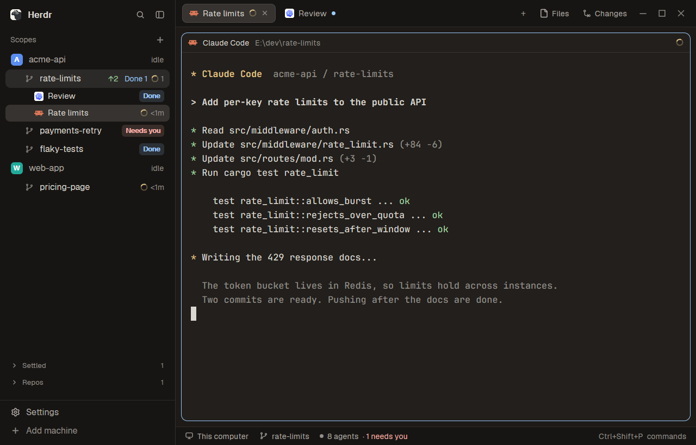

<div align="center">

# Scopes for Herdr

**One sidebar for your repos, worktrees and agents in the [Herdr](https://herdr.dev) desktop app.**

[](LICENSE)
[](https://github.com/herdrdev/herdr-app)



<sub>Sample repos and scripted agents, shot in Herdr with this layout.</sub>

</div>

Herdr's default layout lists spaces and agents separately. Scopes merges them into one tree, so you see which agent works on which worktree, and what needs you, without leaving the list.

## What you get

- **Worktrees under their repo.** A worktree's space sits under its main checkout, found through git. Nothing to configure.
- **A state on every row.** A spinner with the time spent, a red **Needs you**, a blue **Done**, or a quiet `idle`.
- **Unpushed commits.** `↑2` means two commits your remote doesn't have yet.
- **Several agents in one scope.** The row shows how many are in each state, with one row per agent below it. Click one to jump to it.
- **Less clutter.** Hover a scope and press the check to settle it. Settled scopes and checkouts with no agents fold into the **Settled** and **Repos** shelves at the bottom.
- **Other machines.** Once one is connected, the list is grouped per machine.
- **Tabs named by the session.** Tabs use the title the agent sets, and a name you gave one by hand wins. **Files** and **Changes** are remembered per space.

Rows still do what you expect: click to switch, drag to reorder, right-click for the menu.

## Install

Ask your agent, if it runs inside Herdr:

> Add this Herdr layout: https://github.com/DzmitryShut/herdr-scopes

Or copy the files yourself.

macOS, Linux or Git Bash:

```bash
git clone https://github.com/DzmitryShut/herdr-scopes
H="${HERDR_APP_HOME:-$HOME/.config/herdr-app}"
mkdir -p "$H/themes"
cp -n herdr-scopes/themes/*.json "$H/themes/"
cp herdr-scopes/layouts/scopes.* "$H/layouts/"
cp -r herdr-scopes/mods/scopes-* "$H/mods/"
herdr-app do layout.switch --name scopes
```

Windows PowerShell:

```powershell
git clone https://github.com/DzmitryShut/herdr-scopes
$H = if ($env:HERDR_APP_HOME) { $env:HERDR_APP_HOME } else { "$HOME\.config\herdr-app" }
New-Item -ItemType Directory -Force "$H\themes" | Out-Null
Copy-Item herdr-scopes\themes\*.json "$H\themes\"
Copy-Item herdr-scopes\layouts\scopes.* "$H\layouts\"
Copy-Item -Recurse -Force herdr-scopes\mods\scopes-* "$H\mods\"
herdr-app do layout.switch --name scopes
```

Copy the files rather than symlinking them: Herdr's file watcher sees the link, not its target.

`Ctrl+Shift+L` switches back to your previous layout. To remove Scopes, delete `layouts/scopes.json`, `layouts/scopes.svg` and the two `mods/scopes-*` folders.

## What's in the repo

| Path | What it is |
| --- | --- |
| `layouts/scopes.json` | The window: sidebar, tabs, panes and status bar |
| `mods/scopes-sidebar/` | The Scopes list, modified from Herdr's `spaces` mod |
| `mods/scopes-tabs/` | The tab bar, modified from Herdr's `tabs` mod |
| `themes/eyecare-*.json` | The warm dark and light pair from [herdr-eyecare-themes](https://github.com/DzmitryShut/herdr-eyecare-themes) |
| `RECIPE.md` | The brief for rebuilding the layout from scratch |

The layout also uses Herdr's own `workspace-chrome`, `workspace-status`, `pane`, `files`, `changes`, `menu` and `new-menu` mods, so they aren't copied here.

To use your own colors, change or remove `theme` at the root of `layouts/scopes.json`.

## What the mods run

`scopes-sidebar` runs `git status`, `git rev-parse` and `hc machine ls`, and watches each local repo's git folder. It reads git state in the folders your spaces are in, including on connected machines. It writes nothing to your repos and makes no network requests of its own. `scopes-tabs` runs nothing.

## Compatibility

Built and tested on Windows with herdr-app 0.1.11 and the dark theme. Not tested on macOS, Linux or with the light theme. Mods are cloned from one Herdr version, so a later release may need them refreshed from [`RECIPE.md`](RECIPE.md). Git 2.31 or newer is needed.

## License

[Apache-2.0](LICENSE). See [NOTICE](NOTICE) for what comes from where.
