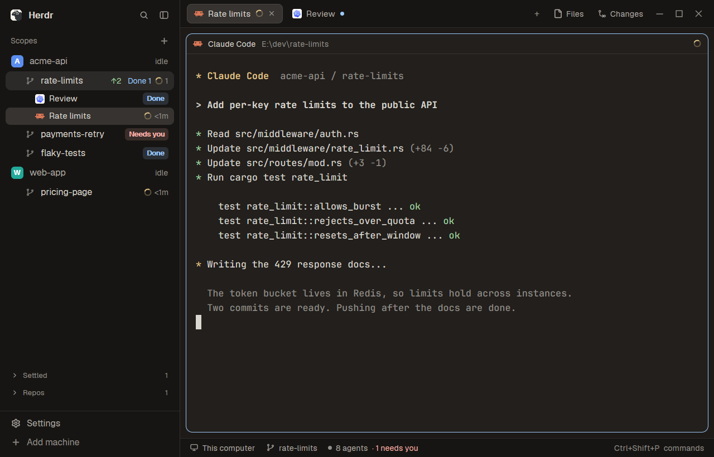

# Scopes

A Herdr window whose left sidebar is one tree of repos, their worktrees and the agents working in them, instead of a spaces list above an agents list. Each row says in a word whether it needs you. To its right are the usual tab bar, terminal panes and status bar, in a warm dark or light theme.



## What you see

Left to right:

- **Sidebar, 268px, `chrome` background, not resizable by dragging.** Top to bottom:
  - Herdr's brand row, 46px, draggable.
  - A 31px header: "Scopes" at 11.5px in `dim`, and a 26px `+` button at the right.
  - The tree, scrolling, 13px text, 8px side padding:
    - **Repo or plain space row**, 30px, radius 8: an 18px avatar with radius 5, its first letter in white, bold, 10.5px, then the name.
    - **Worktree row**, 28px: indented 22px with a 13px branch icon instead of an avatar.
    - **Agent row**, 26px, radius 7, 12.5px text, only when a scope has two or more agents: the program's 14px icon, the agent's name, its state. Indented 44px under a worktree and 35px under a repo.
    - The active space has a `selected` background. The focused agent's row has `raised`.
    - Names are `muted` when the row is quiet or has no agent, and `foreground` otherwise.
  - Two shelves at the bottom, each 26px and 11px in `dim`, with a chevron, a label and a count: **Settled** and **Repos**. Each folds and is hidden when empty.
  - Herdr's footer, 69px.
- **Work column:**
  - **Tab bar**, 42px, draggable. Tabs are 29px, radius 7, 12.8px, with a program icon and a title up to 260px. The active tab has `raised` and a `border`. On the right: `+`, **Files**, **Changes** and the window buttons.
  - **Panes**, 8px padding and gap, radius 10, 1px `border`, `accent` when focused, with a 30px header that is always shown.
  - **Side panel**, 368px, hidden by default: Files or Changes.
  - **Status bar**, 28px.

Avatar colors, one per space, assigned so each hue is used about equally: `#22a99a`, `#e3814f`, `#5b8def`, `#8b7cf6`, `#3fae6a`, `#d9649a`. The theme is `eyecare-dark` and `eyecare-light` on the layout's root: background `#221f1c` in dark, `#f7f3eb` in light.

## How it behaves

A **scope** is a space with an agent or a linked worktree. Worktree spaces sit under their main checkout's space when it has one. A linked worktree without one stays at the top level.

States at the right of a row, most urgent first:

| State | Looks like |
| --- | --- |
| `blocked` | "Needs you" chip: 18px high, radius 5, 10.5px semibold, `blocked` text on the same color at 15% alpha |
| `done` | "Done" chip, same shape, in `done` |
| `working` | A 12px spinner in `working`, 900ms per turn, and the time since work began (`<1m`, `14m`, `3h`, `2d`) in `dim` |
| finished | The word "done" at 11.5px in `done`: the agent still reports done, and the app already shows it as idle because you looked |
| `idle` | The word "idle" at 11.5px in `dim` |

- With two or more agents, the row shows a count per state (`needs 1`, `Done 1`, spinner and `1`, `done 2`, `idle 1`), and agent rows follow, most urgent first.
- `↑2` in `ansi2` before the state means two commits ahead of upstream.
- Click a row to select its space. Click an agent row for `agent.focus`.
- Right-click opens Herdr's `menu` mod as a popup.
- Drag a row onto another to reorder, within one machine. A 2px `accent` line marks the spot.
- Hovering a scope shows a check that settles all its tabs. In the Settled shelf it shows "Unsettle". The press and the release must both land on the button, because the row selects on release.
- A repo with no agent, no worktree scopes under it and no status goes to **Repos**. A space whose tabs are all settled goes to **Settled**.
- Once any other machine is known, rows group under a header per machine (monitor or server icon, name, connection state or `+`, a 6px dot, a chevron). Headers fold. An empty machine offers "New space there". Connecting shows "Loading…".
- A new space waits up to 1.5s for its git answer, so a worktree appears in place rather than jumping.
- Under 160px wide, the sidebar is a rail: each row is the space's number and a glyph, `●` for blocked or done, `·` otherwise.
- Tab titles: a name set by hand wins, then the title the agent set, then the tab's own name or the program's. Titles that look like a path, contain `@`, or repeat the program name don't count.
- Tabs: double-click renames, drag reorders, the wheel changes tab, right-click opens `menu`. `+` opens `new-menu`. Files or Changes open and close per space, and each space remembers its choice.

## Built from

Layout tree:

```text
root row (titlebar none, theme eyecare, preview layouts/scopes.svg)
  sidebar column, 268px, min 44, max 480, background chrome, resizable false
    brand: workspace-chrome, 46px, window_drag
    sidebar-lists column
      spaces: scopes-sidebar, weight 1, min 90
    sidebar-footer: workspace-chrome {footer: true}, 69px
  work column, resizable false
    tabs: scopes-tabs, 42px, window_drag
    work-body row, padding 8, gap 8
      main: active tab, pane header from the pane mod
      panel column, 368px, min 280, max 900, hidden
        panel-body stack: files, changes
    status: workspace-status, 28px
```

Two mods, both `"place": "none"`:

- `scopes-sidebar`, cloned from `spaces`. It uses `spaces`, `panes`, `agents`, `terminals`, `machines`, `hc`, `exec`, `watchFolder`, `setAgentOrder`, `shared` and `setShared` (`space.colors`, `sidebar.width`, `sidebar.collapsed`), `layout`, `window`, `theme`, `openOverlay`, and `localStorage` (`machines.folded`, `shelves`). Commands: `space.select`, `space.move`, `space.new`, `agent.focus`, `tab.settle`, `tab.unsettle`, `layout.resize`.
- `scopes-tabs`, cloned from `tabs`, with its four `win-*.svg` icons. Commands: `tab.select`, `tab.move`, `tab.rename`, `tab.close`, `tab.prev`, `tab.next`, `layout.select`, `layout.show`, `layout.hide`, `window.minimize`, `window.maximize`, `window.close`.

Shipped mods it uses: `workspace-chrome` (its spinner, branch, check, chevron, plus, monitor and server icons too), `workspace-status`, `pane` (its close icon), `files`, `changes`, `menu`, `new-menu`.

Programs:

- `git --no-optional-locks -c core.fsmonitor=false status --porcelain=v2 --branch`
- `git rev-parse --show-toplevel`
- `git rev-parse --path-format=absolute --git-common-dir`
- `hc machine ls --json`, every 15s

A place is `[machine, folder]`, using the space's first terminal's live folder, or else the space's folder. A linked worktree is one whose `--git-common-dir` differs from `<toplevel>/.git`. That common dir is also the repo's identity.

The art is `layouts/scopes.svg`, the picture in Herdr's settings.

## Watch out

- `git status` is not cheap. Ask only when the answer may have changed: a new place, a space that moved, a command or agent turn just ended, a machine came back, a change in a watched local git folder, or a 60s fallback while the window is active.
- Don't let the status write to `.git`. Without `--no-optional-locks` and `core.fsmonitor=false`, the status wakes `watchFolder` and loops.
- Keep looking at one place at a time, and don't remember "not a repo" unless git itself said so. Any other failure can mean a machine is away, so ask again later.
- Keep the agent-name rule in `scopes-sidebar` and the tab-title rule in `scopes-tabs` the same.
- Icon paths include the mod's own folder name (`mods/scopes-tabs/win-min.svg`). Update them on a rename.
- Call `setAgentOrder` with the on-screen order, so `alt-up` and `alt-down` follow the tree.
- `done` becomes idle once a person looks. A scope you're viewing never shows the "Done" chip, only the word "done".
- Needs `--path-format`, so git 2.31 or newer.
- Git paths are matched on forward slashes, which git prints on Windows too.
- Built and tested on Windows with herdr-app 0.1.11 in the dark theme. The macOS traffic-light branches are inherited and untested.

## Done when

- `herdr-app check` passes for both mods, and `herdr-app status` lists no errors after `layout.switch --name scopes`.
- A repo with two worktree spaces shows them as branch-icon rows under it.
- Reporting `\033]7501;state=blocked:app=codex\033\\` from a terminal shows "Needs you" on its row. `working` shows the spinner and a time. `done`, reported while you're on another space, shows the "Done" chip.
- A second agent tab in a scope adds agent rows, and clicking one focuses it.
- Two unpushed commits in a worktree show `↑2`.
- The hover check moves a scope to **Settled**, and "Unsettle" brings it back.
- A repo space with no agents appears under **Repos**.
- A tab whose agent sets a title shows that title until you rename the tab by hand.
- Settings shows `layouts/scopes.svg` as the layout's picture.
